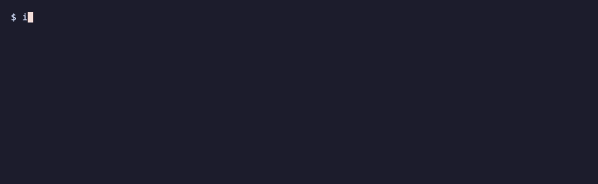

<div align="center">

# infinitic

**Automatically rotate your Claude Code login across accounts before you hit a limit.**

   



</div>

## Use case
When the active account nears its usage limit, infinitic moves Claude Code's login to the best parked account. Every tool that signs in through that login picks up the new account on its own, so sessions keep going without a restart or a `/login` to fresh account.

It supports:
- **Claude Code** — sessions already open continue on the new account.
- **OpenCode v2(v2.2.3+)** — the Claude Agent connected with OAuth.
- **OpenCode v1/v2** with [opencode-claude-auth](https://github.com/griffinmartin/opencode-claude-auth).
- **Other OpenCode-like tools** that read Claude Code's login.

## Install

### Homebrew

```sh
brew install stevejkang/tap/infinitic
```

### Universal (macOS and Linux)

```sh
curl -fsSL https://raw.githubusercontent.com/stevejkang/infinitic/main/install.sh | sh
```

## Quick start

```sh
infinitic import             # register the login already in ~/.claude
infinitic add [email]        # add an account (email is optional)
infinitic status             # usage per account
infinitic service start      # switch automatically, in the background
```

A **bar** is the usage level that triggers a switch. The defaults are 90% of the 5-hour window (`--session`) and 98% of the 7-day window (`--weekly`).

## Commands
> [!NOTE]
> `[]` is optional: without it, a terminal asks which account. `<>` is required.

### Account commands

| command          | does                                          |
|------------------|-----------------------------------------------|
| `add`            | add a Claude account to the pool              |
| `reauth [email]` | renew the refresh token                       |
| `import`         | import the logged-in account from `~/.claude` |
| `rm [email]`     | remove account from the pool, after confirming |
| `rm <email> -y`  | remove it without asking                      |

### Core commands

| command           | does                                            |
|-------------------|-------------------------------------------------|
| `status`          | show usage for each account                     |
| `status --cached` | show the last saved usage without fetching it   |
| `status --json`   | show usage in JSON                              |
| `switch [email]`  | switch the primary login to the given account   |
| `switch --best`   | switch to the recommended account               |
| `use [email]`     | same as `switch`                                |
| `use --best`      | same as `switch`                                |

| command                      | does                                                         |
|------------------------------|--------------------------------------------------------------|
| `service start`              | run `watch` in the background                                |
| `service stop\|status\|logs` | stop the background watch, show its status, or show its logs |
| `service status --json`      | show the background watch's state in JSON                    |
| `service logs -n 50 -f`      | show the last 50 log lines and follow new ones               |

> You can also run `watch` directly if you don't want it in the background.  
> `service start` and `watch` both support `--interval`, `--session`, `--weekly`, and `--config`.  
> `service start --overwrite <options>` writes the given options to config.yml without asking.

### Misc commands

| command              | does                                                          |
|----------------------|---------------------------------------------------------------|
| `update [version]`   | install the latest release or the given one                   |
| `upgrade [version]`  | same as `update`                                              |
| `version [--json]`   | print the version                                             |
| `help --all`         | list every command                                            |
| `help search <words>`| find commands by keyword                                      |
| `completion <shell>` | print the completion script for bash, zsh, fish or powershell |

> `update` restarts a running background watch, if one exists, with the same settings.

### Global options

| option              | does                                                      |
|---------------------|-----------------------------------------------------------|
| `--non-interactive` | never prompt; fail with the input that is needed instead  |
| `--no-color`        | turn off color (also `NO_COLOR`)                          |
| `-d, --debug`       | print diagnostics to stderr, with secrets left out        |

> Prompts are also skipped with `--json`, in CI, and under a coding agent.  
> `<command> --help --json` prints a command's help as JSON.


## Status

```
╭─ Accounts ────────────────────────────────────────────────────────────────────────╮
│   Account  Plan     │ 5h              Reset  │ 7d              Reset   │ Checked  │
│ ● a@x.io   Max      │ ▰▰▰▰▰▰▰▰  95%▲  2h16m  │ ▰▰▰▱▱▱▱▱  40%   2d1h    │ just now │
│ ! b@x.io   Ultra    │ no limit               │ ▰▰▰▰▰▱▱▱  62%   19h59m  │ just now │
│ ○ c@x.io   Max      │ ▰▰▱▱▱▱▱▱  20%   2h16m  │ ▰▱▱▱▱▱▱▱  12%   5d9h    │ 3m ago   │
│ ✗ d@x.io   Pro      │ unknown                │ unknown                 │          │
╰───────────────────────────────────────────────────────────────────────────────────╯
╭─ Attention ───────────────────────────────────────────────────────────────────────╮
│ ! b@x.io  login expires in 2 days  infinitic reauth b@x.io                        │
│ ✗ d@x.io  login revoked: token refresh: invalid_grant …                           │
│           infinitic reauth d@x.io                                                 │
╰───────────────────────────────────────────────────────────────────────────────────╯
  bars   5h 90% · 7d 98%  from ~/.config/infinitic/config.yml
  watch  running in the background (pid 5224)
```

- `●` active
- `○` parked, ready to switch to
- `!` needs a look
- `✗` needs a new login
- `▲` usage at or past its bar

## Settings file

`~/.config/infinitic/config.yml`

- created by `service start` from the options you give and the defaults, when it is missing
- read by `watch`, `status` and the service; their options override it for that run only
- after editing it, run `infinitic service start`

```yaml
interval: 1m     # time between checks (minimum 30s)
session: 90      # maximum 5-hour usage bar, percent
weekly: 98       # maximum 7-day usage bar, percent
```

## Background service

- `service start` registers `infinitic watch --config ~/.config/infinitic/config.yml` with the OS and (re)starts it with the current file and binary.
- `service stop` stops it and removes it from the OS.


|      | infinitic         | macOS                                                   | Linux                                      |
| ---- | ----------------- | ------------------------------------------------------- | ------------------------------------------ |
| unit | `service status`  | `~/Library/LaunchAgents/com.stevejkang.infinitic.plist` | `~/.config/systemd/user/infinitic.service` |
| log  | `service logs -f` | `~/Library/Logs/infinitic/watch.log`                    | `journalctl --user -u infinitic`           |


`service status` shows what the running watch uses and what changed since it started:

```
  watch     running (pid 94720)
  since     Nov 2 16:12
  settings  interval 1m, session 90, weekly 98  ~/.config/infinitic/config.yml
  binary    ~/go/bin/infinitic  v0.4.0
  unit      ~/Library/LaunchAgents/com.stevejkang.infinitic.plist
  logs      ~/Library/Logs/infinitic/watch.log  infinitic service logs --follow
╭─ Attention ──────────────────────────────────────────────────────────────────────────╮
│ ! watch  ~/.config/infinitic/config.yml changed since it started: session: 90 -> 80  │
│          infinitic service start                                                     │
╰──────────────────────────────────────────────────────────────────────────────────────╯
```

The log has one [`log/slog`](https://pkg.go.dev/log/slog) record per check and per switch.

On Linux, user services stop at logout unless you run `loginctl enable-linger`.

## Logins

A login lasts about 28 days. `status` warns 3 days ahead and shows a refused login as `✗ needs reauth`.

`reauth [email]` opens a separate `claude` for `/login` and stores the result where that account lives. A browser already signed in to claude.ai logs in as that account, so use an incognito window for another one.

`/login` in `claude` itself replaces the active account and drops it from the pool.

## JSON

```sh
infinitic status --json            # reads usage now
infinitic status --json --cached   # stored state: no network, no keychain, no lock
```

With `--json`, a failure prints one JSON line on stderr: `{"status":"error","reason":…,"message":…}`, plus `next` commands when there is a fix.

```json
{
  "$schema": "https://raw.githubusercontent.com/stevejkang/infinitic/main/public/schemas/status/v1.json",
  "schemaVersion": 1,
  "observedAt": "2026-10-18T12:56:21Z",
  "source": "live",
  "bars": { "session": 90, "weekly": 98 },
  "active": { "uuid": "2f9c41d0-7e3a-4b8c-a1d2-5e6f7a8b9c0d", "email": "b@x.io" },
  "service": { "installed": true, "running": true, "pid": 5224 },
  "accounts": [
    {
      "uuid": "8a3e7b52-4c1d-4f0e-9b2a-6d5c3e1f7a90",
      "email": "a@x.io",
      "plan": "Team Premium",
      "active": false,
      "health": "ok",
      "overBar": true,
      "loginExpiresAt": "2026-11-15T03:00:00Z",
      "usage": {
        "sampledAt": "2026-10-18T12:56:21Z",
        "windows": [
          { "label": "5h", "percent": 100, "resetsAt": "2026-10-18T13:09:59Z" },
          { "label": "7d", "percent": 39, "resetsAt": "2026-10-24T00:59:59Z" }
        ]
      }
    }
  ]
}
```

## How it works

- Claude Code keeps one login, shared by `claude` and every tool that signs in through it: the `Claude Code-credentials` keychain item on macOS, `~/.claude/.credentials.json` on Linux.
- A login lives in one place, the primary login or a pool slot. Switching **moves** it, because a refresh token is single-use and a copy would be revoked.
- Pool slots are keychain items `infinitic-pool-<uuid>` on macOS and `~/.config/infinitic/pool/<uuid>.json` on Linux. `state.json` holds no secrets.
- Usage comes from the endpoint `claude` uses, at no cost.
- `watch` reads the active account every interval, and the parked ones only when switching.
- An account whose check fails is backed off.
- If the active login dies, `watch` moves to another account.
- Accounts are named by their exact email or UUID.

## Which account is next

Weekly quota left over when the 7-day window resets is gone. So infinitic uses up the account whose week ends soonest and saves fresh weeks for later. Taking the account with the most room would do the opposite: start a new week while another one runs out unused.

### Room for a switch

- **Room** is how far usage is below the bar. With the default 7-day bar of 98%, an account at 60% has 38% room.
- **Switch cost.** The new account has no prompt cache for the conversation, so its first request processes the whole context again. infinitic assumes this costs 15% of the 5-hour window and 3% of the 7-day window on Pro.
- **Other plans** get the same usage as a share of their larger limits, so the percentage shrinks by plan size: a Max account (5× Pro) loses 3% and 0.6%.
- **Safety factor.** An account needs that cost times $`K = 1.5`$ as room, so a larger than usual context still stays under the bar.

```math
\text{room needed} = \frac{K \times \text{cost on Pro}}{\text{plan size}}, \qquad K = 1.5
```

Plan sizes are the published usage multiples. The costs are estimates, so the room needed is too.

| plan          | size (5h / 7d) | room needed in 5h (estimated) | room needed in 7d (estimated) |
|---------------|----------------|-------------------------------|-------------------------------|
| Pro           | 1 / 1          | 22.5%                         | 4.5%                          |
| Team Standard | 1.25 / 1.25    | 18%                           | 3.6%                          |
| Max           | 5 / 5          | 4.5%                          | 0.9%                          |
| Team Premium  | 6.25 / 6.25    | 3.6%                          | 0.72%                         |
| Ultra         | no 5h / 10     | -                             | 0.45%                         |

Ultra has no 5-hour limit, so it needs no 5-hour room.

### The order

1. Only parked, healthy accounts with known usage, a successful last check and enough room in both windows are considered.
2. Accounts whose week ends within 3 days go first, soonest first. Resets less than an hour apart count as a tie, broken by:
   - no per-model cap at the weekly bar,
   - the sooner 5-hour reset, since that usage comes back first (no 5-hour limit counts as soonest),
   - the most weekly quota left, scaled by plan size. 10% on Team Premium is more than 20% on Pro.
3. Then the rest. A started week goes before an untouched one, because touching it starts a new week. Then no per-model cap at the weekly bar, then the most room in the tighter window, in percent.
4. If no account has enough room, infinitic still switches, since staying over the bar is worse. It takes any account under both bars, without a full per-model cap first, then the one closest to enough room. This logs `event=candidate_margin_relaxed`. If no account is under the bars, `watch` stays and logs how many it skipped.
5. If the picked account's login doesn't work, the next one is tried.

### Example

Five parked Team Premium accounts, default bars. Each needs 3.6% room in the 5-hour window and 0.72% in the 7-day window.


|   | 5h  | resets | 7d    | resets | most room | infinitic |                                                         |
|---|-----|--------|-------|--------|-----------|-----------|---------------------------------------------------------|
| A | 20% | 30m    | 70%   | 1d6h   | 4th       | **1st**   | same deadline as B, but its 5-hour window refills first |
| B | 10% | 4h     | 60%   | 1d6h   | 3rd       | **2nd**   | same deadline as A                                      |
| C | 30% | 2h     | 50%   | 4d4h   | **2nd**   | 3rd       | nothing expiring soon, week already started             |
| D | 0%  | -      | 0%    | -      | **1st**   | 4th       | using it starts a new week, keep it for later           |
| E | 5%  | 1h     | 97.5% | 10h    | skipped   | skipped   | 0.5% of the week left, less than a switch costs         |


A and B both lose what is left of their week tomorrow. A goes first because its 5-hour window resets in 30 minutes, so whatever it spends now comes back first. Most room would start with D's fresh week while A's 28% and B's 38% expire unused.

## Development

```sh
go test ./...
INFINITIC_TEST_KEYCHAIN=1 go test ./internal/credstore   # writes throwaway keychain items; use a VM
```

> `INFINITIC_*` variables point paths and endpoints at a fake server and throwaway credentials. They are listed in [`config.go`](cmd/infinitic/config.go).
